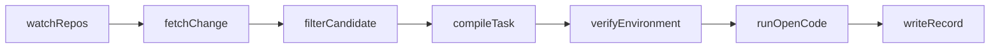

# db_pipeline

Пакет решает две задачи, и у каждой своя точка входа.

**Harvesting — `python -m db_pipeline`.** Сборщик задач по ядру СУБД: он готовит экземпляры, которые позже кладутся в pg-gym. Стадии Airflow, журнал, фильтр, оракул и обход истории описаны ниже.

**Benchmark — `python -m db_pipeline.benchmark`.** Изолированный прогон агента на одной PostgreSQL-задаче и парный smoke `bare`/`graph`. Поведение перенесено из commit-suite pg-gym, но реализовано своим кодом: одноразовый контейнер без bind mounts, скрытые тесты, оборванная история, gates, verdict, модель через свой model-gateway, трасса Langfuse v4 и свой граф кода по MCP. Harvesting CLI при этом не меняется — прогоны и сборка живут в одном пакете, но не мешают друг другу.

Текущее состояние — локальный checkpoint на ветке `feat/postgres-isolated-runner`. Парный smoke пяти задач ещё не завершён; фактический отчёт по последнему прогону лежит в [docs/smoke-fact-report-2026-11-11.md](docs/smoke-fact-report-2026-11-11.md).

Включены три ядра: DuckDB, PostgreSQL и SQLite. У каждого свой DAG и свой образ инструментов.

Общий образ на три ядра не собирается, потому что у ядер разные компиляторы, зависимости и программы проверки. DuckDB собирается через CMake и Ninja. PostgreSQL нуждается в bison, flex и ICU. SQLite гоняет тесты через `testfixture` и Tcl. Команда сборки и команда теста тоже свои. Стенд потом оценивает ядра по отдельности, поэтому инструментальный слой сборщика остаётся раздельным.

Одновременно собирается одно ядро. Docker на этой машине выделено 16 ГиБ: DuckDB и PostgreSQL компилируются в три потока, а линковка DuckDB остаётся однопоточной. Сами образы при этом маленькие: в них нет исходников конкретного sha и нет ключа модели. Дерево монтируется снаружи.

Сборщик и стенд оценки агентов остаются разными компонентами. Образ, в котором сборщик проверяет коммит, и образ, в котором стенд прогоняет агента, живут отдельно. У pg-gym свой образ PostgreSQL уже есть, и прогон агента на стенде идёт в нём.

У benchmark-прогона свои образы: `docker/task.Dockerfile` (toolchain PostgreSQL + OpenCode 1.18.20), `docker/graph.Dockerfile` (MCP-сервер графа) и `docker/model-gateway/Dockerfile` (единственная точка с ключом OpenRouter). Ключ модели в task-образ не попадает.

План DuckDB: [plans/2026-10-10_mvp_пайплайн_duckdb.md](../plans/2026-10-10_mvp_пайплайн_duckdb.md). План PostgreSQL и SQLite: [plans/2026-10-10_postgres_sqlite_пайплайн.md](../plans/2026-10-10_postgres_sqlite_пайплайн.md). Сбор новых SQL-коммитов: [plans/2026-10-18_сбор_новых_sql_коммитов.md](../plans/2026-10-18_сбор_новых_sql_коммитов.md). Сбор коммитов ядра: [plans/2026-10-19_сбор_коммитов_ядра.md](../plans/2026-10-19_сбор_коммитов_ядра.md). Парный smoke пяти задач: [plans/2026-11-10_парный_smoke_пяти_задач.md](../plans/2026-11-10_парный_smoke_пяти_задач.md).

## Что делает цепочка

Три DAG на TaskFlow API Airflow 2.11: `duckdb_pipeline`, `postgres_pipeline`, `sqlite_pipeline`. Стадии — одни и те же функции пакета, граф передаёт id ядра.




Закреплённый запуск берёт один заранее записанный кандидат. `--harvest` идёт по истории и останавливается, когда оракул принял `--accept` задач.

1. `watchRepos` в закреплённом запуске делает `git fetch` включённой строки `repos.toml` и берёт кандидата из конфига: PR 26419 у DuckDB, следующий образец pg-gym у PostgreSQL, закреплённый sha у SQLite. `--harvest` этот шаг заменяет обходом `git log` первой родительской линии, от новых коммитов к старым. У DuckDB в окно попадают коммиты `origin/main`, в теме которых есть `(#номер)`. У PostgreSQL и SQLite — коммиты `master`. История добирается `git fetch --deepen`, пока не набрано `--scan` коммитов, которых ещё нет в журнале. Курсор лежит в `data/cursors/<core>.json` и отмечает последний уже просмотренный sha: следующее окно начинается сразу после него.
2. `fetchChange` достаёт родительский sha, diff, сообщение, номер PR и постановку. Источник постановки пишется в `statement_source`: `issue`, `pr` или `commit_message`. Текст issue читается с GitHub, если ссылка есть. Документация в условие не подмешивается с текущего HEAD. В `--harvest` постановка PostgreSQL и SQLite — сообщение коммита. У DuckDB по-прежнему issue, описание PR или сообщение коммита.
3. `filterCandidate` отсекает merge-сообщение, revert, только документацию, форматирование и переименование без тестов, массовое обновление сгенерированных ответов TPC-H/TPC-DS и изменение без одновременной правки кода и тестов. Повторный sha не получает вторую запись. В `--harvest` код и тесты берутся из префиксов ядра в `repos.toml`. Коммит PostgreSQL без изменённого `expected/*.out` получает `no_oracle_test` и не собирается. Запись журнала с причиной ровно `нет правки SQL-кода` и без запуска оракула для harvest не считается известной и разбирается снова. Для DuckDB так же повторно разбирается пропуск `нет правки SQL-тестов`: это подхватывает старые записи после расширения тестовых префиксов. Принятый оракулом sha второй JSON не получает.
4. `compileTask` режет diff коммита между родителем и самим коммитом. У DuckDB и SQLite рез идёт по префиксам из `repos.toml`: тесты попадают в `test_patch`, код — в скрытый `gold_patch`. В закреплённом запуске PostgreSQL рез идёт по спискам `test_files` и `solution` образца, потому что и код, и регресс лежат под `src/`. В `--harvest` всё под `src/test/regress/` попадает в `test_patch`, остальной diff коммита — в `gold_patch`. Имя теста берётся из `expected/<имя>.out`.
5. `verifyEnvironment` поднимает контейнер из шаблона своего ядра: `docker/duckdb.Dockerfile`, `docker/postgres.Dockerfile` или `docker/sqlite.Dockerfile`. В образе только инструменты сборки. Исходники конкретного `base_sha` монтируются снаружи. Экземпляр остаётся, если тесты из задачи падают до эталона и проходят после него.
6. `runOpenCode` в закреплённом запуске стартует OpenCode процессом рядом с контейнером. В образ ключ не кладётся. Температура 0, лимит шагов 50, таймаут 1800 с. Пустой diff записывается как pass ложь. Если оракул экземпляр не принял, эта стадия пропускается. `--harvest` эту стадию не вызывает: экземпляр для датасета готов после оракула.
7. `writeRecord` пишет JSON задачи и JSON запуска отдельно. Повторный прогон того же sha не создаёт второй файл задачи.

Если фильтр или оракул отвергают изменение, цепочка всё равно доходит до `writeRecord`. Причина и лог лежат в журнале. Необработанное исключение посередине таким завершением не считается.

## Экземпляр

Экземпляр — одна задача датасета, по которой потом можно поднять дерево, показать агенту условие и проверить его diff. Это один sha или один PR после фильтра и разреза. Файл лежит в `data/tasks/<instance_id>.json`. Прогон агента в этот файл не входит: он пишется отдельно в `data/runs/`.

Поля ниже стенд уже умеет потреблять. Имена не переименовываются.


| Поле               | Смысл                                                    |
| ------------------ | -------------------------------------------------------- |
| `instance_id`      | `duckdb__duckdb-<номер PR>` или `<репозиторий>-<sha>`    |
| `repository`       | репозиторий ядра из `repos.toml`                         |
| `license`          | лицензия из `repos.toml`                                 |
| `base_sha`         | родитель коммита, на нём собирается дерево               |
| `statement`        | постановка                                               |
| `statement_source` | `issue`, `pr` или `commit_message`                       |
| `test_patch`       | патч тестов, агенту отдаётся                             |
| `gold_patch`       | эталон кода, агенту не показывается                      |
| `fail_to_pass`     | тесты, которые должны упасть до эталона и пройти после   |
| `pass_to_pass`     | пустой список: полный регресс в этот проход не входит    |
| `oracle`           | имя проверки ядра: `unittest`, `pg_regress` или `testfixture` |
| `reject_reason`    | пусто, если оракул принял экземпляр                      |


В задаче дополнительно лежат `head_sha` и `pr_number`. В запуске: `model`, `harness`, `temperature`, `pass`, `empty_diff`, `duration_seconds`, `step_limit`, `timeout_seconds`.

Закреплённый экземпляр DuckDB — `duckdb__duckdb-26419`, issue 26401. Тест `test/sql/subquery/exists/test_issue_26401.test` падает до эталона (`0 <> 1`) и проходит после. Логи: `data/oracle/fea4498ea5e7ba7687aab2619417eed9139960eb/`.

Первые принятые `--harvest` экземпляры, каждый не из закреплённого списка: `sqlite__sqlite-3bce1260e7ef` (`test/date.test`), `duckdb__duckdb-25817` (`test/sql/function/list/lambdas/reduce_captured_columns.test`), `postgres__postgres-1a846a555afb` (регресс `foreign_key`).

## Что видит агент

Агенту отдаются постановка и `test_patch`. `gold_patch` хранится для проверки и в промпт не входит. На `base_sha` сначала накладывается тестовый патч: эти тесты должны падать. Затем накладывается эталон кода: те же тесты должны проходить. После попытки агента тестовые файлы возвращаются к патчу задачи, чтобы закрыть тест правкой самого теста было нельзя.

`test_patch` — это кусок diff между родителем и коммитом, в котором остались только тесты. У DuckDB и SQLite граница берётся из префиксов `repos.toml`. В закреплённом запуске PostgreSQL граница берётся из списков `test_files` и `solution` готового образца. В `--harvest` граница — каталог `src/test/regress/`. Код ядра уходит в `gold_patch`.

Так устроен SWE-bench и SWE-rebench: проверяющий тест агенту виден, исправление скрыто. Готовый diff кода в условие не входит. Тест, по которому агента оценивают, в условие входит.

С pg-gym совпадают состав источников и набор полей, которые стенд потом может прочитать. Набор `commit` в pg-gym на время работы агента снимает регрессионный тест с диска и оставляет `goal`, область и имена файлов, которыми его будут оценивать. Текст этого правила лежит в `suites/commit/src/suite.py`. JSON этого сборщика в pg-gym пока не импортируется. При импорте нужно явно выбрать видимость теста: показать `test_patch`, как в этом сборщике, или спрятать тест, как в наборе `commit`.

## Оракул

Оракул — программа, которая решает, годится ли коммит в датасет и верен ли ответ агента. Поле `oracle` называет эту программу, чтобы задачи трёх ядер можно было хранить рядом и проверять правильной командой.

| Ядро | Поле `oracle` | Чем проверяется |
|---|---|---|
| DuckDB | `unittest` | бинарник тестов ядра, только файлы из `fail_to_pass` |
| PostgreSQL | `pg_regress` | в закреплённом запуске тест из образца; в `--harvest` имя из изменённого `expected/*.out` |
| SQLite | `testfixture` | TCL-тест `test/*.test` |

Чужой оракул на чужое ядро не ставится: падение `pg_regress` и падение `testfixture` устроены по-разному. Коммит остаётся в наборе, если тесты падают на базе с тестовым патчем и проходят после скрытого эталона. Та же проверка потом отличает удачный diff агента от неудачного. OpenCode запускается только после того, как оракул экземпляр принял.

## Конфиг источников

`repos.toml`. Watchdog смотрит только строки с `enabled = true`.


| id       | Репозиторий                | Лицензия           | Оракул        | Сейчас                      |
| -------- | -------------------------- | ------------------ | ------------- | --------------------------- |
| duckdb   | github.com/duckdb/duckdb   | MIT                | `unittest`    | закреплён PR 26419; `--harvest` читает `origin/main` |
| postgres | зеркало git.postgresql.org | PostgreSQL License | `pg_regress`  | закреплённый запуск читает образцы pg-gym; `--harvest` читает `master` |
| sqlite   | github.com/sqlite/sqlite   | public domain      | `testfixture` | закреплён sha `bfb858c596f6`; `--harvest` читает `master` |


Префиксы кода DuckDB: `src/`, `extension/core_functions/`. Встроенные функции ядра лежат во втором пути, это не отдельный репозиторий расширений. Префиксы тестов: `test/sql/`, `test/optimizer/`, `test/api/`, `test/common/`, `test/issues/`. Каталоги `extension/tpch/dbgen/answers/` и `extension/tpcds/dsdgen/answers/` считаются массовой генерацией и отсекаются.

Узкий SQL-срез снят. Для `--harvest` код — это ядро. DuckDB: `src/` или `extension/core_functions/` и тест из `test/sql/`, `test/optimizer/`, `test/api/`, `test/common/` или `test/issues/`. PostgreSQL: `src/backend/` и `src/test/regress/` с изменённым `expected/*.out`. `contrib` и `src/bin` кодом ядра не считаются. SQLite: любой файл `src/`, кроме амальгамы `sqlite3.c` и `sqlite3.h`, и `test/*.test`. Каталог `ext/` кодом ядра не считается.

Команда сборки и теста заморожены после первой успешной сборки, а не взяты из статьи:

```text
CMAKE_BUILD_PARALLEL_LEVEL=3 make release DISABLE_SHELL=1 DISABLE_PARQUET=1 CMAKE_VARS_BUILD=-DDUCKDB_RELEASE_LINK_JOBS=1
build/release/test/unittest {test}
```

При 16 ГиБ Docker unity-сборка запускает три компилятора. Сборка без unity этим GCC не компилируется (`incomplete type` в `partitioned_sort.cpp`). Линкер оставлен один, parquet выключен. Расширения извне не клонируются.

Кандидаты оракула, не больше одной содержательной сборки на PR: 26419, затем 26057, затем 26460. Первый принят, два других не собирались.

## Каталог

```text
repos.toml                     три ядра, лицензии, префиксы, команды
.env.example                   пример окружения без секретов; реальный .env игнорируется
docker/duckdb.Dockerfile       инструменты сборки DuckDB, без исходников и без секрета
docker/postgres.Dockerfile     инструменты сборки PostgreSQL
docker/sqlite.Dockerfile       инструменты сборки SQLite и testfixture
docker/task.Dockerfile         образ benchmark-задачи: toolchain PostgreSQL и OpenCode
docker/task-entrypoint.sh      entrypoint task-контейнера: распаковка дерева, маркер готовности
docker/graph.Dockerfile        образ MCP-сервера графа
docker/model-gateway/          gateway к OpenRouter с allowlist модели
docker/compose.benchmark.yml   ручной диагностический сценарий gateway и графа
docker/langfuse/               локальный стек Langfuse v4: compose, пример окружения, справка
Makefile                       цели управления стеком Langfuse
dags/duckdb_pipeline.py        DAG DuckDB
dags/postgres_pipeline.py      DAG PostgreSQL
dags/sqlite_pipeline.py        DAG SQLite
prompts/opencode_system.txt
prompts/opencode.json          температура 0 и 50 шагов, ключ не хранится
src/db_pipeline/               стадии harvesting и модель экземпляра
src/db_pipeline/environment.py загрузка корневого .env на границе CLI
src/db_pipeline/benchmark/     benchmark: конвертер, runner, session, probe, opencode, telemetry
src/db_pipeline/benchmark/graph/ индекс, store, cutoff, MCP-сервер и probe-клиент
docs/                          протокол, изоляция, Langfuse, граф, smoke, происхождение, отчёт факта
tests/                         фильтр, разрез патча, журнал, конвертер, граф, изоляция, окружение
constraints/                   constraints Airflow 2.11 для Python 3.11
data/                          в gitignore: клон, журнал, JSON, логи, индекс, AIRFLOW_HOME
```

`data/` не коммитится. Туда попадают:

- `data/clones/<ядро>` — частичный клон; у DuckDB глубина из конфига 200, `--harvest` при необходимости углубляет историю;
- `data/cursors/<ядро>.json` — последний просмотренный sha обхода;
- `data/journal/<sha>.json` — одна запись на sha;
- `data/tasks/<instance_id>.json` — экземпляр;
- `data/runs/<instance_id>.json` — прогон;
- `data/oracle/<sha>/` — логи сборки, «до» и «после»;
- `data/benchmark/postgres/{tasks,oracle,prep}` — публичные задачи, приватные oracle и prep-патчи benchmark-прогона;
- `data/graph/postgres.sqlite` — SQLite-индекс графа (union пяти баз);
- `data/reports/smoke-postgres.json` — сводный отчёт парного smoke;
- `data/filter_sample.jsonl` — журнал фильтра на 20 изменениях;
- `data/decisions.md` — фактические команды и ошибки среды;
- `data/airflow/` — свой отдельный Airflow.


## Окружение

Python 3.11, зависимости через `uv`, виртуальное окружение в `.venv`. Airflow ставится с официальными constraints, иначе разрешение зависимостей уходит в сторону. Пакет `cryptography` остаётся на 42.0.8 из этих constraints: у 50.0.2 нет колеса macOS x86_64, а локальный CPython 3.11 собран под x86_64.

```bash
cd НИР/db_pipeline
UV_CONSTRAINT=constraints/airflow-2.11.0-3.11.txt uv sync
```

Проверки пакета:

```bash
uv run python -m pytest tests -q
uv run mypy
uv run pyright
```

Тесты совместимы и с `unittest`: `uv run python -m unittest discover -s tests`.

Фильтр на размеченной выборке заново пишет `data/filter_sample.jsonl`. Метки в `tests/fixtures/labeled_changes.json` после просмотра решения фильтра не меняются. Если совпадение падает ниже 16 из 20, правятся префиксы в `repos.toml`, а не разметка. Расхождения пишутся в `data/filter_notes.md`. Сейчас совпадение 20 из 20. То же правило для двадцаток ядра `tests/fixtures/labeled_sql_duckdb.json`, `labeled_sql_postgres.json` и `labeled_sql_sqlite.json`: на каждом ядре 20 из 20, заметки `data/<ядро>_sql_filter_notes.md`. Эти двадцатки фиксируют правило «код ядра и прежний тест». Узкий срез трёх файлов SQLite, `adt/` и только `core_functions/` больше не является критерием.

## Запуск

Ручной. Расписание в `repos.toml` пустое: для недели его достаточно не включать.

Airflow исполнитель — SequentialExecutor, база — SQLite внутри `data/airflow`, интерфейс — порт 8088.

```bash
export AIRFLOW_HOME="$PWD/data/airflow"
export AIRFLOW__CORE__EXECUTOR=SequentialExecutor
export AIRFLOW__CORE__LOAD_EXAMPLES=False
export AIRFLOW__CORE__DAGS_FOLDER="$PWD/dags"
export AIRFLOW__DATABASE__SQL_ALCHEMY_CONN="sqlite:///$AIRFLOW_HOME/airflow.db"
export AIRFLOW__WEBSERVER__WEB_SERVER_PORT=8088
uv run airflow db migrate
uv run airflow dags list
uv run airflow dags test duckdb_pipeline 2026-10-10
```

Тот же проход без планировщика проводит одно ядро до журнала. Повтор на том же sha останавливается на фильтре и не создаёт второй JSON задачи. DAG остаётся этим закреплённым проходом.

```bash
uv run python -m db_pipeline --core duckdb
uv run python -m db_pipeline --core postgres
uv run python -m db_pipeline --core sqlite
```

Закреплённый PostgreSQL читает три JSON из `suites/commit/data/samples`. Постановка — поле `goal` такого образца. После трёх отказов оракула поиск останавливается. SQLite в этом запуске берёт закреплённый sha, постановка — сообщение коммита.

Обход коммитов ядра — отдельный флаг. История идёт от новых к старым. `--scan` задаёт, сколько коммитов смотреть в одном окне, `--accept` — сколько задач должен принять оракул за это окно. `--oracle-budget` ограничивает число сборок за окно; 0 оставляет сборки без потолка. OpenCode в этом режиме не запускается. Повтор того же sha второй JSON не создаёт, курсор сдвигается, следующий запуск продолжает историю. После записи журнала `--harvest` стирает `data/work/<sha>`; DAG Airflow пока не на этом обходе, и когда их переведут, удаление придёт через `run_harvest`.

```bash
uv run python -m db_pipeline --core sqlite --harvest --scan 40 --accept 1
uv run python -m db_pipeline --core duckdb --harvest --scan 40 --accept 1
uv run python -m db_pipeline --core postgres --harvest --scan 40 --accept 1
```

Несколько ядер идут одной командой, по порядку флагов `--core`. Следующее ядро стартует, когда предыдущее добрало `--goal` или история кончилась. Перед каждым окном программа считает в `data/journal` записи с `oracle_status=accepted` этого ядра. В окно уходит недостача до `--goal`, уже лежащие задачи входят в этот счёт. Число 300 в код не вшито. Без `--goal` или с `--goal 0` очередь идёт до конца истории. Ошибка сбора останавливает очередь. Одно ядро без `--goal` по-прежнему смотрит одно окно и слушает `--accept`.

```bash
uv run python -m db_pipeline --harvest --core sqlite --core duckdb --core postgres --goal 300 --scan 5000
```

Образ инструментов, если его ещё нет:

```bash
docker build -t db-pipeline-duckdb-tools:local -f docker/duckdb.Dockerfile docker
```


## OpenCode

Раздел описывает harvesting-прогон (`python -m db_pipeline`); поведение benchmark-прогона отличается (см. ниже).

Модель `deepseek/deepseek-v4-flash`, обвязка `opencode`, температура 0. Ключ читается из переменной `OPENROUTER_API_KEY` в момент прогона. В Dockerfile, в git и в `data/` он не записывается. OpenCode стоит на хосте и правит смонтированное дерево. После прогона тестовые файлы возвращаются к патчу задачи, чтобы агент не мог закрыть тест правкой самого теста. Затем оракул пересобирает дерево и гоняет `fail_to_pass`.

Пустой diff — ошибка модели: в поле `pass` пишется ложь. Один такой прогон уже записан для `duckdb__duckdb-26419`: модель отработала около 22 минут, код выхода 0, рабочего diff после прогона не осталось, поэтому pass ложь. Установленный CLI не принимает `--auto`; процесс запускается с `--dangerously-skip-permissions`. Пять повторов, как в оригинальном SWE-rebench, в этот проход не входят.

## Benchmark-прогон PostgreSQL

Отдельная точка входа `python -m db_pipeline.benchmark` переносит поведение commit-suite из pg-gym: одноразовый контейнер без bind mounts, скрытые тесты, оборванная история, gates, verdict и трасса Langfuse v4. Сборщик harvesting (`python -m db_pipeline`) при этом не меняется.

### Команды

```bash
uv run python -m db_pipeline.benchmark convert          # watchdog → commit-suite
uv run python -m db_pipeline.benchmark validate         # проверить публичную часть и источник
uv run python -m db_pipeline.benchmark doctor           # Docker и Langfuse
uv run python -m db_pipeline.benchmark build            # собрать образы задачи, графа и gateway
uv run python -m db_pipeline.benchmark run <sha> --mode bare
uv run python -m db_pipeline.benchmark run <sha> --mode graph
uv run python -m db_pipeline.benchmark probe            # дешёвый E2E probe gateway и MCP
uv run python -m db_pipeline.benchmark smoke            # парный smoke bare/graph на пяти задачах
uv run python -m db_pipeline.benchmark graph-index      # индекс графа с отсечкой
uv run python -m db_pipeline.benchmark graph-index --union --per-base 50
```

Конвертер раскладывает карточки `data/tasks/postgres__*.json` в публичную задачу (`area`, `goal`, `contract`, `graded_by`) и приватный oracle (`head`/`base`, reverse source patch, тестовый патч, эталон). Публичная часть не содержит эталона и содержимого тестов.

### Оркестрация

Smoke ведёт себя сам, без compose: на сессию поднимается одна внутренняя сеть и один model-gateway, на каждый graph-run — отдельный одноразовый graph-container с копией union-индекса. Порядок условий чередуется (B/G, G/B, B/G, G/B, B/G), сессии не переиспользуются. Ноль MCP-вызовов в graph-run считается ошибкой интеграции, а не результатом.

`docker/compose.benchmark.yml` оставлен как ручной диагностический сценарий: он поднимает gateway и граф с постоянной внешней SQLite, а `BENCH_GRAPH_BASE_SHA` задаётся вручную.

### OpenCode и Model-gateway

Эффективный конфиг OpenCode генерируется на каждый run и передаётся в контейнер, а не берётся из образа: `bare`-конфиг MCP не содержит, `graph`-конфиг подключает сервер графа как remote Streamable HTTP (`http://graph:8765/mcp`). Hash конфига пишется в manifest. Task-container не видит `OPENROUTER_API_KEY` — ключ живёт только в model-gateway, который проверяет allowlist модели и разрешает лишь OpenAI-compatible endpoints.

Лимиты прогона сведены в `BenchmarkConfig` и попадают в manifest как `step_limit` (реальный `agent.build.steps`; флага лимита у `opencode run` нет) и `max_tokens` (потолок ответа модели, по умолчанию 2048: 4096 не вмещался в остаток кредитов ключа и обрывал генерацию с первой секунды). Перед batch `pairwise` проверяет ключ и остаток кредитов OpenRouter, а шлюз повторяет ответы 402/429 по `Retry-After`.

### Граф кода

Свой MCP-сервер с тремя инструментами: `find_code_symbols` (символы C-кода по имени до cutoff), `read_versioned_source` (реальный фрагмент файла на закреплённой ревизии с SHA-256 и byte span), `search_git_history` (сообщения коммитов, hunks и тела кода). Любая возвращаемая revision обязана быть предком `base_sha`; `head_sha` и его потомки не выдаются, нулевой результат пишется в audit log.

Union-индекс строится по последним 50 предкам каждого из пяти `base_sha`, дельта коммитов дополняется снимком полного source-дерева каждой базы (иначе неизменившийся файл вроде `relnode.c` агенту недоступен). Индекс передаётся в graph-container копией SQLite, полный git-клон в контейнер не монтируется.

### Отчёт

Run records immutable: каждый прогон пишется отдельным файлом в `data/runs/` с session/run ID и не перезаписывает предыдущие. Сводный отчёт `data/reports/smoke-postgres.json` содержит pass@1, gates, test outcomes, latency, tokens, tool counts, MCP calls, effective base/head, ссылки Langfuse и отчёт cleanup. На пяти задачах выводится только работоспособность E2E, не статистическая значимость эффекта графа.

Модуль `benchmark/completion.py` помечает каждый прогон категорией (`ok`, `self_stop_empty`, `infra_fail_truncated`, `infra_fail_wall`, `length`, `step_limit`, `crash_unknown`). В пары McNemar идут только `ok` и `self_stop_empty`: отказы API считаются отдельным счётчиком, иначе измеряется надёжность шлюза, а не эффект графа.

Документация: [docs/protocol.md](docs/protocol.md), [docs/isolation.md](docs/isolation.md), [docs/langfuse.md](docs/langfuse.md), [docs/graph-cutoff.md](docs/graph-cutoff.md), [docs/smoke.md](docs/smoke.md), [docs/provenance.md](docs/provenance.md), [docs/smoke-fact-report-2026-11-11.md](docs/smoke-fact-report-2026-11-11.md).

### Секреты и `.env`

Корневой `.env` загружается только на границе CLI (`load_environment`, `override=False`): уже экспортированные переменные имеют приоритет, отсутствующий файл не является ошибкой, значения не логируются. Реальный `.env` игнорируется git; пример без секретов — [.env.example](.env.example). Ключ OpenRouter нужен только model-gateway, ключи Langfuse — только хосту-оркестратору.

```bash
cp .env.example .env
# заполнить OPENROUTER_API_KEY и ключи LANGFUSE_*
```

## Чего в этом компоненте нет

Импорт JSON в pg-gym, повтор 104 задач, пять повторов и языковой отбор. Хостовый путь `opencode_run.py` больше не участвует в benchmark-прогоне: агент работает в task-контейнере, а ключ модели выдаёт model-gateway.

Полного парного smoke 5×2 пока нет: последний запуск остановлен после четырёх прогонов, сводный `data/reports/smoke-postgres.json` не дописан (см. [docs/smoke-fact-report-2026-11-11.md](docs/smoke-fact-report-2026-11-11.md)).

## Внешние зависимости

Кодовая зависимость только одна — сам pg-gym как источник образцов, и то на стороне harvesting, а не benchmark:

- `repos.toml` указывает `samples_dir = "../db_agent_gym/pg-gym/suites/commit/data/samples"`;
- `src/db_pipeline/postgres_report.py` и `src/db_pipeline/samples.py` ищут зеркало `pg-gym/stand/pg.git`.

Код `postgres_gym` не импортируется и не устанавливается. Для benchmark-прогона эти пути не нужны: задачи и oracle уже сконвертированы в `data/benchmark/postgres`. Индекс графа собирается из локального клона `data/clones/postgres`.

## Стек Langfuse

Langfuse v4 входит в репозиторий: `docker/langfuse/docker-compose.yml` поднимает web, worker, clickhouse, minio, redis и postgres в своей compose-сети. Внешних сетей нет, наружу открыт только web на `127.0.0.1:3100`. `db_pipeline` публикует трассы по OTLP на `LANGFUSE_URL` (по умолчанию `http://localhost:3100`).

```bash
cp docker/langfuse/.env.example docker/langfuse/.env
# заполнить секреты стека и LANGFUSE_INIT_*
make langfuse-up
make langfuse-health
```

Ключи проекта из `docker/langfuse/.env` (`LANGFUSE_INIT_PROJECT_PUBLIC_KEY`/`LANGFUSE_INIT_PROJECT_SECRET_KEY`) должны совпадать с `LANGFUSE_PUBLIC_KEY`/`LANGFUSE_SECRET_KEY` корневого `.env`. Справка и таблица портов — [docker/langfuse/README.md](docker/langfuse/README.md), детали трассировки — [docs/langfuse.md](docs/langfuse.md).
